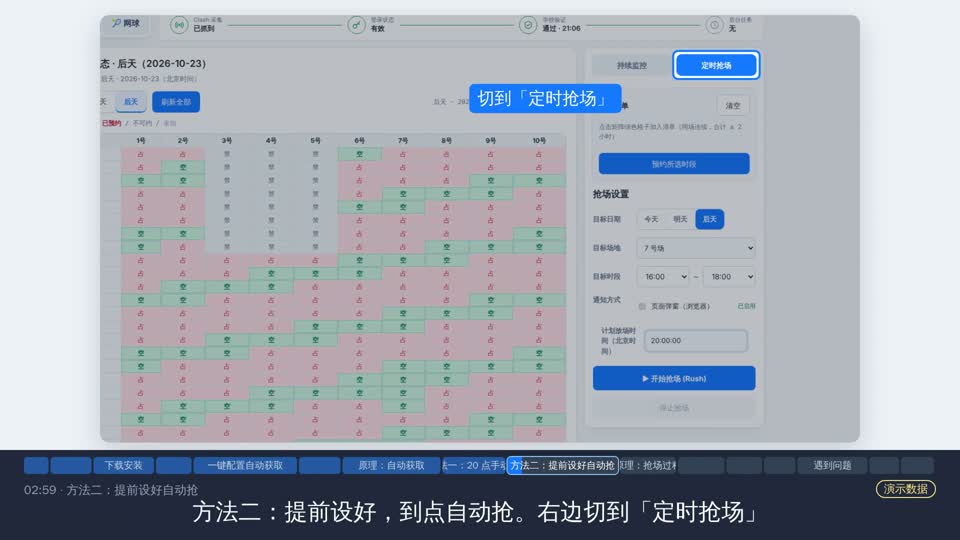

# Court Booking Workbench

Windows 本机场地预约工作台：提前设置定时抢场，或持续关注退订后出现的空场。

代码整理自已测试的 `f599a84` 版本，保留运行所需的平台适配。适用于特定预约平台，不支持任意网站。仓库改名不构成匿名保证。

## 开始前准备

1. **打开并登录电脑版企业微信。** 从工作台进入官方场地预约页面，确认能正常看到场馆和场地。使用期间保持企业微信及预约页面打开，电脑保持联网、不休眠；自动恢复登录需要这个窗口。配置脚本提示重新打开客户端时，再按提示操作。
2. **准备好能自定义分流规则的代理客户端。** 推荐的自动获取流程使用 Clash Verge Rev；其他客户端先按 [配置指南](docs/CAPTURE_SETUP.md) 或交给本地 Agent 检查。Clash 路线需要规则模式，系统代理或 TUN 至少启用一个，并确认企业微信流量确实经过客户端。只针对预约站点添加规则，具体修改交给配置脚本逐项确认，不需要为了本工具开启全局模式。
3. **选择安装方式。** 命令行方式需要 Git、Python 3.13 x64 和 PowerShell；使用 Agent 方式需先准备好有本机终端权限的 Claude Code / Codex；ZIP 免安装版自带 Python。

以上代理准备针对**自动获取登录信息**的方式。不愿修改代理或证书时，可以尝试页面连接脚本，但官方客户端需要支持开发工具，且不能保证登录失效后自动恢复。安装好工作台也不等于已接入账号，仍需完成登录同步和只读验证。

## 快速开始

选择一种方式即可：熟悉终端就复制命令，不熟悉就把提示词交给自己电脑上的 Claude Code、Codex 等本地 Agent。

### 方式一：复制命令启动

适用 Windows 10/11 x64。先安装 Git 和 Python 3.13 x64（包含 `py` 启动器），然后在 PowerShell 中逐行执行。任意一步报错先停下，解决后再继续；同名目录已存在时不要覆盖。

```powershell
git clone https://github.com/John030427/court-booking-workbench.git
cd court-booking-workbench
py -3.13 -m venv .venv
.\.venv\Scripts\python.exe -m pip install --require-hashes -r release/requirements-win.lock
powershell -ExecutionPolicy Bypass -File .\run-local.ps1
```

浏览器打开 [http://127.0.0.1:8766/](http://127.0.0.1:8766/)。首次进入先检查「设置 → 测试模式」：当前默认真实预约，演练前请开启测试模式。服务启动后还需要接入自己的账号。

需要自动获取登录信息时，保持服务窗口开着，在仓库目录另开 PowerShell，执行以下入口，并按提示逐项确认：

```powershell
.\setup-capture.cmd
```

配置说明与撤销方式见 [账号接入指南](docs/CAPTURE_SETUP.md)。后续启动只需在仓库目录运行：

```powershell
powershell -ExecutionPolicy Bypass -File .\run-local.ps1
```

### 方式二：复制提示词交给 Agent

把下面整段交给**使用者自己电脑上有终端权限的本地 Agent**。普通网页聊天不会自动获得本机操作权限。

```text
请帮我在这台 Windows 电脑上安装并启动 Court Booking Workbench，
然后协助我接入自己的账号。请用中文沟通。

仓库：https://github.com/John030427/court-booking-workbench

1. 先检查 Windows 版本、Git、Python 3.13 x64、目标目录和 8766/8080
   端口占用。已有安装就先核实并复用，不覆盖文件、不杀占用端口的程序。
   Git/Python 缺失时说明安装方案，征得我同意后安装。
   提醒我登录电脑版企业微信，从工作台打开官方预约页并保持窗口开启。
   检查 Clash Verge Rev 或其他代理客户端是否支持自定义规则，以及当前
   规则模式、系统代理/TUN 和企业微信流量路径；先检查，不擅自切换。
2. 读取仓库 README.md、docs/QUICKSTART.md、docs/CAPTURE_SETUP.md，
   克隆到合适目录，创建 .venv，使用 Python 3.13 和
   release/requirements-win.lock 安装带哈希校验的依赖。
3. 用 run-local.ps1 启动，检查本机 /api/health，只输出版本、数据目录
   和任务是否运行等安全字段。不要把“服务已启动”说成“账号已接入”。
4. 接着阅读 docs/LOCAL_AGENT_CAPTURE_PROMPT.md，按我实际使用的代理
   客户端选择接入方式。修改代理、规则或证书前，说明影响、备份与撤销
   方法，等我确认；只处理目标预约站点，保留其他流量走向。
5. 不打印或上传 Token、Cookie、手机号、身份编号、代理密钥和证书私钥，
   不展示凭证预览，不让我把这些信息粘贴到聊天里。
6. 不启动抢场或监控，不调用下单接口，不清空订单记录，不自动切换测试
   模式。需要平台只读验证前先问我，需要官方登录或人工验证时让我操作。
7. 完成后告诉我启动/退出方式、当前测试模式、账号接入进度、未完成的
   人工步骤和如何撤销网络配置。讲解抢场和持续监控，最终目标由我设置。
```

已经装好工作台、只需要配置登录接入时，直接使用 [专用配置提示词](docs/LOCAL_AGENT_CAPTURE_PROMPT.md)。不想安装 Git/Python 时，也可以使用下方的 ZIP 免安装版。

## 教程、配置脚本和 AI 提示词

这些文件已经放在本仓库，可以直接在线查看，不必为了阅读它们下载程序压缩包：

| 你需要什么 | 直接打开 |
| --- | --- |
| 从安装到抢场、监控的完整教程 | [快速开始](docs/QUICKSTART.md) |
| 如何配置自动获取登录信息，以及如何撤销 | [配置说明](docs/CAPTURE_SETUP.md) |
| 交给自己电脑上的 Claude Code / Codex 帮忙配置 | [复制这里的提示词正文](docs/LOCAL_AGENT_CAPTURE_PROMPT.md) |
| 一键配置入口（源码版） | [setup-capture.cmd](setup-capture.cmd) |
| 配置脚本源码 | [scripts/capture_setup.py](scripts/capture_setup.py) |
| 撤销入口（源码版） | [undo-capture.cmd](undo-capture.cmd) |

提示词用于使用者自己的电脑。填写自己的环境后交给本地 AI，它会先检查再逐步确认配置。源码版入口需要完整仓库和已安装依赖的 `.venv`，不能只下载一个 CMD 文件运行。

不想搭建源码环境时，再使用下面的免安装程序 ZIP；包里的对应入口名为 `配置自动获取.cmd` 和 `撤销自动获取配置.cmd`。

[下载 Windows 程序](https://github.com/John030427/court-booking-workbench/releases/tag/v2026.10.22-f599a84) · [观看新手视频（5 分 39 秒）](https://github.com/John030427/court-booking-workbench/releases/download/v2026.10.22-f599a84/tutorial-final.mp4) · [详细图文教程](docs/QUICKSTART.md)

[](https://github.com/John030427/court-booking-workbench/releases/download/v2026.10.22-f599a84/tutorial-final.mp4)

## 下载与启动

在 [Releases](https://github.com/John030427/court-booking-workbench/releases) 下载 Windows x64 免安装程序 ZIP 和 `SHA256SUMS.txt`。GitHub 自动生成的 Source code ZIP 只有源码，不含运行时。

1. 核对 SHA-256 后，把程序 ZIP 解压到普通文件夹，不要直接在压缩软件内运行。
2. 双击 `启动工作台.cmd`，浏览器会打开 `http://127.0.0.1:8766/`。发行包自带 Python，无需另装 Python、Git 或 Node。
3. 打开「设置 → 测试模式」。**当前版本默认真实预约**，首次演练先开启测试模式。
4. 按下面的步骤接入自己的账号；没有有效登录信息不能查询和预约。
5. 再次双击会复用已运行的服务。关闭网页不会退出服务，需要退出时使用页面入口或 `停止工作台.cmd`。

仅在本机使用，不要把端口暴露到公网。关机、休眠或退出服务会影响任务执行。

## 首次接入账号

完整步骤见 [快速开始](docs/QUICKSTART.md) 和 [自动获取配置说明](docs/CAPTURE_SETUP.md)。

| 你的情况 | 使用方式 |
| --- | --- |
| 使用 Clash Verge Rev，希望自动获取登录信息 | 运行包里的 `配置自动获取.cmd`，阅读提示并逐项确认 |
| 使用其他代理客户端，或配置脚本中途停止 | 使用 [给本地 Claude Code / Codex 的提示词](docs/LOCAL_AGENT_CAPTURE_PROMPT.md) |
| 不愿修改代理或证书 | 使用工作台设置里的页面连接脚本，前提是官方客户端开放开发工具 |

自动采集需要配置目标域名分流与当前用户证书。脚本会提示备份和撤销；保留这些记录，不要共享证书私钥或关闭安全软件。仅使用自己的合法账号并遵守预约平台规则。

接入成功要分别确认：**页面或采集通道连接 → 登录信息同步 → 学校只读验证通过**。同步成功不代表凭证永远有效。恢复能力取决于接入方式、官方登录会话和窗口状态；重新登录及人工验证需要本人完成。

## 定时抢场

1. 选择运动，在右侧打开「定时抢场」。
2. 填实际使用场地的日期、目标时段和候选场地。
3. 填平台的放号日期与时间。**放号时间和使用日期不同**；相对日期按设置当天解释。
4. 检查账号状态、费用条件及测试模式，再核对确认弹窗里的日期、星期、时段和场地顺序。
5. 确认后保持电脑开机、联网、不休眠，保留恢复登录需要的官方窗口。
6. 查看任务结果，并到官方「我的预约」核对最终订单。

适配平台常用流程为晚间放号后预约后天场地，以官方公告为准。场地表中的「20:00 自动切到后天并刷新」只刷新表格，不会代你创建任务。

工具不保证预约成功。查询成功只代表请求完成，不代表存在匹配空场。

## 持续监控

例如在 16:00–21:00 内寻找任意连续 1.5 小时，而不是要求五小时全部空闲。

1. 选择日期、场地范围和搜索时段。
2. 「预约时长」选 1 / 1.5 / 2 小时。
3. 初次建议选「只提醒我」；选「自动预约」表示满足条件时可能直接提交真实订单。
4. 设置「盯多久」，包括 24 小时。目标时段结束等条件可能提前结束任务，不会跨日自动更换目标。
5. 查看任务卡片区分查询、登录待恢复和结束状态；鉴权暂停期间不会下单。

关闭网页后后台可继续运行，网页弹窗提醒需要页面开着。全局测试模式与「只提醒我」是不同设置。

## 两种运动同时使用

羽毛球和网球各有独立任务，共享账号、请求预算及下单保护。同一天两个运动时段不能重叠，同一运动不能同时运行定时抢场和监控。并行不保证同时预约成功。

## 常见问题

| 现象 | 处理方式 |
| --- | --- |
| 本机网页打不开 | 检查启动提示、服务日志和端口占用，不随意结束其他进程 |
| 官方页出现 502 | 检查本机代理及分流回环，按备份撤销本工具增加的配置 |
| 已连接但验证失败 | 看同步和验证时间，区分鉴权、网络和平台业务异常 |
| 登录失效后没有刷新 | 检查恢复选项、接入方式及官方登录窗口，必要时本人重新登录 |
| 没有匹配目标 | 核对具体日期、连续时长、候选场地和费用条件 |
| 结果未确认或订单冲突 | 先核对官方订单，不清空记录或连续重试绕过保护 |

## 视频教程

完整视频已作为 Release 附件提供：[观看或下载 MP4](https://github.com/John030427/court-booking-workbench/releases/download/v2026.10.22-f599a84/tutorial-final.mp4)。点击本页封面也可打开视频；浏览器可能直接播放或下载，下载后用本机播放器观看即可。

视频为 1080p、中文配音和字幕，约 5 分 39 秒、29.6 MB。章节已写入 MP4，支持章节的播放器可直接跳转：

| 时间 | 内容 |
| --- | --- |
| 00:25 | 下载与安装 |
| 01:03 | 一键配置登录信息自动获取 |
| 01:42 | 确认账号接入 |
| 02:35 | 手动选择空场 |
| 02:59 | 提前设置定时抢场 |
| 04:02 | 查看预约结果 |
| 04:20 | 两种运动同时抢场 |
| 04:34 | 持续监控 |
| 04:47 | 遇到问题与退出 |

视频包含标注过的演示数据和示意画面。安装部分演示的是 EXE 安装版，本次附件提供 ZIP 免安装版，请按上面的「下载与启动」操作；持续监控面板已有更新，以当前界面和图文步骤为准。

## 数据与更新

源码模式数据在仓库目录；发行包数据在 `%LOCALAPPDATA%\SustechReservation\data`。不要混淆这两份数据，也不要上传自己的配置。运行时锁文件位于 `release/`，构建入口为 `scripts/build_release.py`。

更新前结束自己的任务，保留配置和订单记录；不要清空未确认订单。不再使用采集方式时，按配置记录撤销本工具添加的规则和证书，再删除程序。

反馈时提供版本、Windows 版本、复现步骤和脱敏错误。截图遮住登录参数、身份信息和订单；不要上传整个数据目录、Token、Cookie、证书或原始抓包。

## 来源与许可

基于 [fynngwu/badminton_scripts](https://github.com/fynngwu/badminton_scripts) 修改。本次未发现上游明确的开源许可证，不宣称为 MIT 或 Apache 等开放许可，上传也不代表取得额外授权。原版本的来源与限制说明见 [NOTICE](NOTICE.md)，第三方许可随程序包提供。
